  
  
  

---

## 🏛️ About Me

**Urban & Regional Planner** operating at the convergence of quantitative urban theory, spatial demographic modeling, and production-grade GIS software engineering.

Urban planning decisions are only as robust as the predictive analytics and spatial models running beneath them. The question that directs my work is:

> **Which parts of urban planning and demographic forecasting can be made computationally reproducible — and what does a city gain in disaster resilience and infrastructural equity when they are?**

I approach this through two interconnected disciplines:
1. **Applied Spatial Science**: Multi-scenario demographic projection (Cohort-Component method), composite disaster vulnerability assessment (CDVI), and spatial accessibility analysis.
2. **Computational Tooling**: Engineering native PyQGIS plugins built on a strict 4-layer architecture (`core/`, `gis/`, `processing_provider/`, `ui/`), ensuring zero external `pip` dependencies and dual-runtime compatibility across **QGIS 3 LTR (Qt5)** and **QGIS 4 (Qt6)**.

<table>
  <tr>
    <td align="center" width="25%"><a href="https://plugins.qgis.org/plugins/kent_ongoru/"><strong>#6775</strong></a> Official QGIS Plugin Hub ID</td>
    <td align="center" width="25%"><strong>Dual Runtime</strong> Native QGIS 3 (Qt5) &amp; QGIS 4 (Qt6)</td>
    <td align="center" width="25%"><strong>0 Dependencies</strong> Pure Python core &amp; native OpenXML engine</td>
    <td align="center" width="25%"><strong>Open Science</strong> Deterministic algorithms &amp; automated E2E tests</td>
  </tr>
</table>

---

## 🗺️ Research & Engineering Pillars

Four computational pillars designed to bridge theoretical city planning with operational desktop GIS workflows:

<table>
  <tr>
    <td width="50%" valign="top">
      <h3>🛡️ Disaster Risk &amp; Spatial Vulnerability</h3>
      
<em>Which urban quarters carry the highest compounded shock exposure?</em>

      
Composite Disaster Vulnerability Index (CDVI) modeling integrating structural, demographic, socioeconomic, and physical hazard indicators into unified spatial vulnerability surfaces.

      
<strong>Methods</strong> · Multi-Criteria Evaluation · Spatial Normalization · Vulnerability Matrices 
      <strong>Output</strong> · Actionable disaster resilience zoning &amp; priority intervention indices

    </td>
    <td width="50%" valign="top">
      <h3>👥 Demographic Cohort-Component Forecasting</h3>
      
<em>Where will the population grow, and what cohorts will require civic facilities?</em>

      
Dynamic demographic projection engine simulating 0–85+ age cohorts, age-specific fertility rates (ASFR), survival curves, and multi-scenario migration dynamics across future projection horizons.

      
<strong>Methods</strong> · Cohort-Component Modeling · Demographic Survival Surfaces · Scenario Branching 
      <strong>Output</strong> · Longitudinal demographic trajectories &amp; age-pyramid distributions

    </td>
  </tr>
  <tr>
    <td width="50%" valign="top">
      <h3>⚡ Dual-Runtime Systems Architecture</h3>
      
<em>Can advanced planning algorithms run seamlessly across both Qt5 and Qt6?</em>

      
Cross-runtime PyQGIS adaptation layer ensuring clean execution across QGIS 3.44 LTR and QGIS 4.2.3 without code duplication or deprecated Qt bindings.

      
<strong>Methods</strong> · <code>gis/compat.py</code> Scoped Enum Bridges · Headless Automated E2E Testing 
      <strong>Output</strong> · Robust plugins passing 2026 QGIS Hub security &amp; runtime gates

    </td>
    <td width="50%" valign="top">
      <h3>📊 Zero-Dependency Reporting &amp; Visualization</h3>
      
<em>Can planners generate audit-ready analytical reports without installing external libraries?</em>

      
Native in-memory OpenXML <code>.xlsx</code> generation and 300 DPI <code>QPainter</code> vector charts written from scratch using Python standard libraries.

      
<strong>Methods</strong> · Zero-Dependency OpenXML · Vector Canvas Rendering · In-Memory Zip IO 
      <strong>Output</strong> · High-resolution reports and spreadsheets ready for municipal councils

    </td>
  </tr>
</table>

---

## 🏙️ Featured Flagship Suite: Kent Öngörü

  <table>
    <tr>
      <td width="65%" valign="top">
        <h3><a href="https://plugins.qgis.org/plugins/kent_ongoru/">Kent Öngörü — Spatial Demographic &amp; Risk Forecasting Suite</a></h3>
        
<b>Official QGIS Plugin Hub ID: <code>6775</code></b> · Verified on both QGIS 3 LTR and QGIS 4.

        
A comprehensive analytical toolbox designed for city planners, researchers, and public administrations:

        <ul>
          <li><b>Cohort-Component Forecasting:</b> Multi-scenario projection for 0–85+ male and female cohorts.</li>
          <li><b>CDVI Spatial Vulnerability Engine:</b> Weighted composite risk assessment over building inventory and demographic exposure.</li>
          <li><b>Processing Toolbox Integration:</b> Full <code>QgsProcessingAlgorithm</code> implementations for Graphical Modeler automation.</li>
          <li><b>Standalone Core Layer:</b> 100% pure Python domain math, fully decoupled from GUI for instantaneous unit testing.</li>
        </ul>
        

          
          
        

      </td>
      <td width="35%" align="center" valign="middle">
        
      </td>
    </tr>
  </table>

---

## 🛠️ Methodological Toolbox & Technical Stack

 

> **Spatial & Analytical Methods:**  
> Demographic Cohort-Component Analysis · Age-Specific Fertility Modeling (ASFR) · Multi-Criteria Evaluation (MCE) · Spatial Normalization · Composite Disaster Vulnerability (CDVI) · Dual-Runtime PyQGIS Architecture · Headless Automated E2E Testing · Zero-Dependency OpenXML Spreadsheet Generation · 300 DPI Vector Graphics (`QPainter`) · Spatial Database Schema Design (`PostGIS` / `SpatiaLite`).

---

## 📡 Contribution Signal & Activity

  <table border="0">
    <tr>
      <td>
        
      </td>
      <td>
        
      </td>
    </tr>
  </table>

  

    
  

  

    
<b>🐍 View Automated Contribution Snake Map</b>

     
    
  

---

  Open spatial science, resilient urban planning, and reproducible computational systems.
   
  <a href="https://github.com/berkaymemis"><b>github.com/berkaymemis</b></a>

